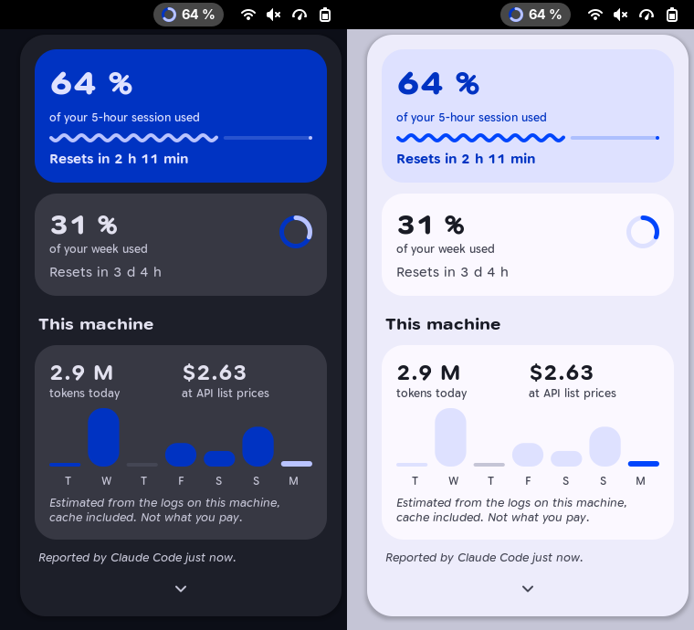
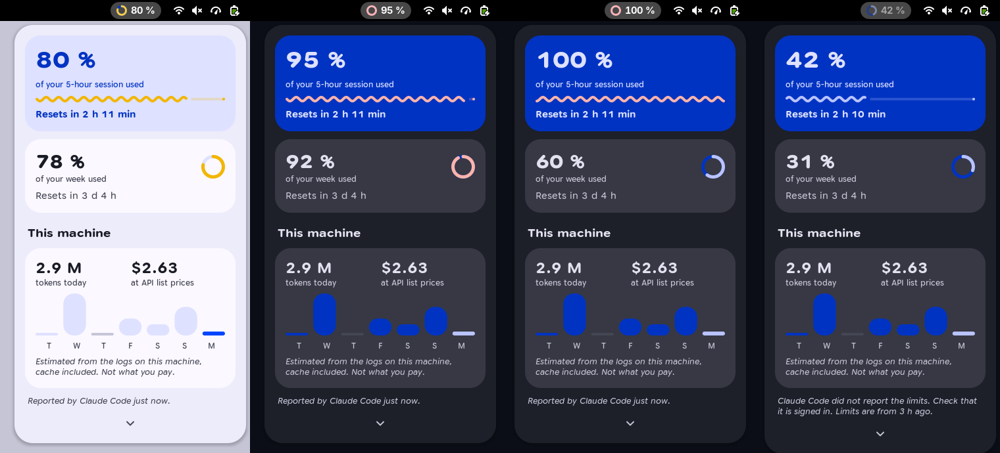
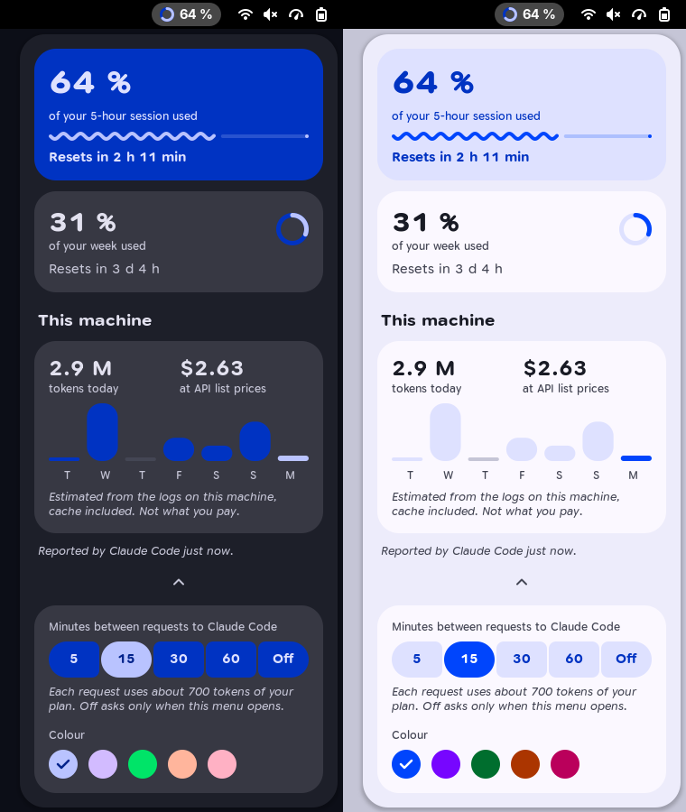
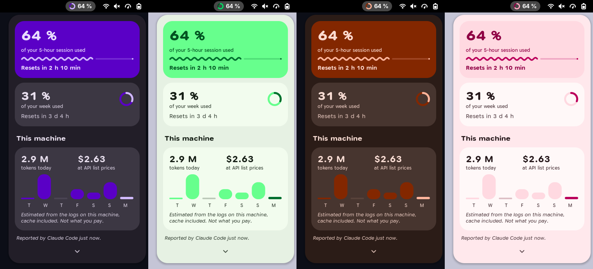
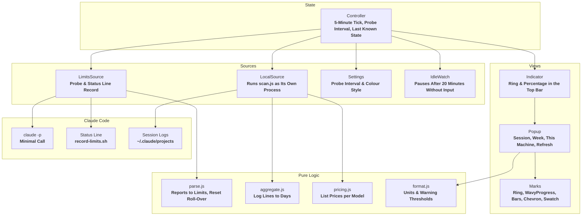

<div align="center">
  <h1>Tally</h1>
  <p><strong>A GNOME Shell extension that shows how much of your Claude plan is used: the 5-hour session as a ring in the top bar, the week and this machine's tokens in a menu.</strong></p>

  <p>
    
    
    
    
    
    
    
    
  </p>
</div>

---



**Tally** answers one question without opening anything: how much of the current **5-hour session** is gone. A ring and a percentage sit in the top bar; a click shows the **week**, the time until each limit resets, and what **this machine** used today.

It has one source for the limits, **Claude Code** itself. The extension never reads your sign-in and makes no network request of its own. There is no account, no server and no analytics.

Tally is an independent project. It is not made, endorsed or supported by **Anthropic**; Claude and Claude Code are Anthropic's names for its own products.

The screenshots on this page show sample data.

---

## Features

- **Ring in the Top Bar:** The share of the **5-hour session** that is used, as a ring and a number, directly left of the system menu.
- **Warning Colours:** The ring and the progress turn to the warning colour from **75 %** and to the error colour from **90 %**.
- **Session and Week:** Each with its percentage and the time until it resets.
- **A Travelling Wave:** A session at **100 %** turns its progress into a wave that moves while the menu is open.
- **This Machine:** Today's **tokens**, their **estimated cost** at API list prices, and one bar for each of the last **7 days**.
- **Your Own Pace:** How often the limits are asked for is set in the menu: every **5**, **15**, **30** or **60 minutes**, or only when the menu opens.
- **A Look on Hover:** Resting the pointer on the top bar item shows the menu for as long as it stays there; a click holds it open.
- **Ask Now:** A button beside the age of the limits asks Claude Code at once, for when the limits changed without a window ending.
- **Out of Date, and Saying So:** When no fresh value can be had, the last one stays, dimmed, and one sentence says why.
- **Five Colour Styles:** **Blue**, **violet**, **green**, **orange** and **pink**, each in light and dark.
- **Light and Dark:** The menu follows the system's colour scheme.

---

## The Menu

### Session

- **The One Loud Tile:** The percentage in large type, a **wavy progress** for what is used and a straight track for what is left.
- **Reset:** One sentence with the time until the session starts again. A session whose reset has passed shows **0 %** until the next report.

### Week

- **Weekly Limit:** The percentage, a ring, and the time until the week resets.

### This Machine

- **Tokens Today:** Every token of today's **Claude Code** sessions on this machine, cache included.
- **Estimated Cost:** What those tokens would cost at **API list prices**. On a subscription you do not pay this amount; the tile says so.
- **Seven Days:** One bar per day, today in the accent colour.



### Settings

The chevron at the bottom of the menu opens the two settings. They close again when the menu does.

- **Minutes Between Requests:** How often Claude Code is asked for the limits. **Off** asks only when the menu opens, and then at most every 5 minutes.
- **Colour:** One of five styles, chosen from a row of dots. The ring in the top bar follows it.



---

## Where the Numbers Come From

### Plan Limits

The limits are reported by **Claude Code**, in two ways.

| Source | When | Cost |
| :--- | :--- | :--- |
| **Probe** | Every **5**, **15** (default), **30** or **60 minutes**, as set in the menu, when the menu opens, and when **Ask now** is pressed | One minimal **`claude -p`** call: about **700 input tokens** on the smallest model, from your plan |
| **Status line** | After every answer of a Claude Code session in a **terminal** | None |

- **The Probe:** The extension runs Claude Code with no tools, no settings, no plugins and a one-line system prompt, and reads the limits from the events Claude Code prints. The call leaves no session log behind.
- **The Status Line:** `install.sh` can extend the status line command in **`~/.claude/settings.json`** with **`record-limits.sh`**, which writes the limits to a file. While a terminal session reports this way, the probe waits. The **desktop app** does not run the status line, which is why the probe exists.
- **Nobody There, Nothing Asked:** After **20 minutes** without keyboard or pointer input the probe and the log scan pause, and the first input resumes them. On the lock screen GNOME switches the extension off, and a suspended machine runs nothing.
- **The Newer One Wins:** Whichever source reported last is shown, with its age in the footer of the menu.

### Local Usage

- **Session Logs:** `scan.js` reads **`~/.claude/projects/**/*.jsonl`** of the last 7 days as its own **gjs** process, so large logs cannot stall the desktop.
- **Counted Once:** A message that is logged several times counts once, at its most complete usage.
- **Prices:** A table of API list prices per model in **`extension/lib/pricing.js`**. A day with a model the table does not know shows its tokens and no amount.

### What Leaves the Machine

Only what Claude Code sends on its own: the probe is an ordinary, very short request to Claude. The extension itself opens no connection, and it does not read **`~/.claude/.credentials.json`**.

---

## Look and Feel

The interface is built with **Toms Expressive Design**, the design system in **`toms-expressive-design/`**.

- **One Loud Thing:** The session is the only tile in the accent container; everything else is neutral.
- **Numbers Lead:** A large number, a quiet label that says what it is, and at most one sentence beside it.
- **Type With a Voice:** **Google Sans Flex**, a variable font. Numbers are heavy and wide, labels narrow and quiet, notes slanted.
- **Motion That Means Something:** The ring glides to a new value, numbers count up when the menu opens, and nothing moves at rest. With animations switched off in GNOME, values are set at once.
- **Generated, Not Typed:** `tools/build-tokens.js` writes the stylesheet and the colour values from **`toms-expressive-design/tokens.json`**. No colour is written by hand.

Each colour style is one **seed** of the design system, turned into a full set of roles by the **Material 3 vibrant scheme**. The warning and error colours stay the same in every style.

| Style | Seed |
| :--- | :--- |
| **Blue** (default) | `#3f5bd9` |
| **Violet** | `#7b4bd6` |
| **Green** | `#2e9e4f` |
| **Orange** | `#f26b3a` |
| **Pink** | `#e0407b` |



---

## Getting Started

You need **GNOME Shell 50**, **Claude Code** signed in with a Claude subscription, and **jq** for the status line.

**1. Clone:**
```bash
git clone https://github.com/tomsliikee/tally.git
```

**2. Install:**
```bash
./tally/install.sh
```

**3. Log out and back in.** GNOME Shell on Wayland loads a new extension only at login.

The script links the extension into **`~/.local/share/gnome-shell/extensions`**, enables it, installs **Google Sans Flex** when the machine has none, and asks before it extends the status line. The previous settings are kept beside the file as **`settings.json.before-tally`**.

To update, `git pull` and log in again.

**Run the checks:**
```bash
for t in tests/*.test.js; do gjs -m "$t"; done
```

**Regenerate the stylesheet** after changing the template or the design tokens:
```bash
node tools/build-tokens.js
```

The styles in **`tools/styles.json`** only change when a seed does. **`tools/derive-styles`** derives them again; it needs **Dart** and the `material_color_utilities` package, both part of a **Flutter** installation.

---

## How It Works

Three layers: **sources** that fetch, **pure logic** that runs outside the shell and is covered by **27** unit tests, and **views** drawn with **St** and **Cairo**.



### Data Storage & Disk Paths

| Path | Purpose |
| :--- | :--- |
| **`~/.cache/tally/limits.json`** | The limits of the last probe: percentages and reset times |
| **`~/.cache/tally/statusline.json`** | The limits last recorded from the status line |
| **`~/.config/tally/settings.json`** | The chosen probe interval and colour style |
| **`~/.claude/settings.json`** | Claude Code's settings; `install.sh` extends the status line command there, after asking |
| **`~/.claude/projects/`** | Claude Code's session logs. Read only |

---

## Platform Support Matrix

| Platform | Status |
| :--- | :--- |
| **GNOME Shell 50** on **Wayland** (Fedora 44) | ***Tested*** in a headless shell; ***built*** for the real session, where it has only run in an earlier version |
| Other GNOME Shell versions | ***Planned***: `metadata.json` names version 50 only |

| Part | State | How |
| :--- | :--- | :--- |
| **Formatting, parsing, aggregation, pricing** | *tested* | 27 unit tests |
| **Log scan** | *tested* | Daily sums compared with an independent count of the same logs |
| **Top bar item and menu, light and dark** | *tested* | Rendered in a headless GNOME Shell 50.5 with sample states |
| **Limits from a probe** | *tested* | Run on 2026-10-12, both with the week above its 75 % warning and, after a reset, with the session at 4 % and the week at 0 % |
| **Limits from the status line** | *tested* | A sample record is picked up and parsed, and a real record written by Claude Code was found on 2026-10-12 |
| **Probe interval and the chevron** | *tested* | Clicked in the headless shell; the timing itself was not waited out |
| **Look on hover** | *tested* | A virtual pointer in the headless shell, over the overview: nothing when crossing, the menu after resting, gone on leaving, held by a click, no look after closing with a click on the item. Not tried over windows |
| **Ask now** | *tested* | Clicked twice in the headless shell: one probe ran, the button read "Asking…" and was inert until the new limits were shown |
| **Colour styles** | *tested* | The derived blue equals the design system's own tokens in all 52 values; all five styles rendered, one chosen by a click and saved |
| **Pause when idle** | *tested* | In the headless shell with a 2-second threshold and a virtual pointer: no probe or scan while idle, both after the first input. Suspend and the lock screen were not tried |
| **Motion** | *built* | Runs without errors; not watched on a real screen |

---

## License

**Tally** is released under the [**MIT License**](LICENSE).

The font in **`toms-expressive-design/fonts`**, **Google Sans Flex**, is the work of the Google Sans Flex Authors and comes under the **SIL Open Font License 1.1**; its text is in [`toms-expressive-design/fonts/OFL.txt`](toms-expressive-design/fonts/OFL.txt).
